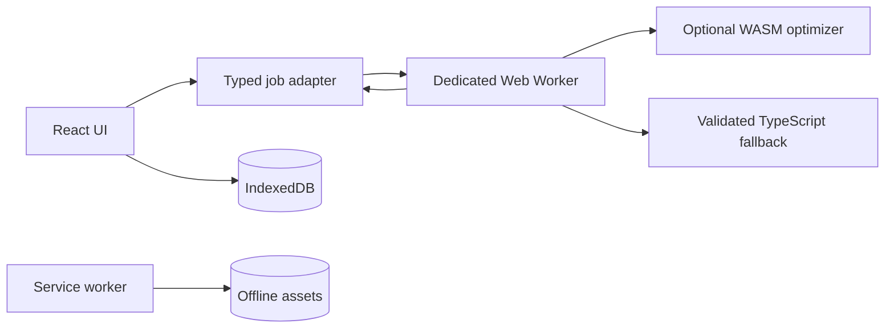

# IDX workspace and compute contract

The existing pnpm monorepo remains authoritative. The IDX configuration adds a development environment; it does not replace the current app or its tooling.



## Job envelope

```ts
type ComputeRequest<T> = {
  jobId: string;
  kind: "nest" | "draft" | "stitch";
  schemaVersion: 1;
  payload: T;
  maxDurationMs: number;
};
type ComputeResponse<T> =
  | { jobId: string; status: "ok"; result: T; engine: "wasm" | "typescript" }
  | { jobId: string; status: "error"; code: string; message: string };
```

Worker inputs must be immutable and validated. Preserve grain direction, nap, cut counts, mirrored pieces, seam allowances and fabric width. Never claim optimal nesting without a lower bound or proof. Cancellation and stale-result suppression belong to the adapter. WASM initialization failure must fall back to tested TypeScript behavior.

## Measurement safety

Camera landmarks do not establish accurate body circumferences by themselves. Do not automatically replace tape measurements with model estimates. Show source, calibration, uncertainty and explicit user review before drafting. Raw photographs are not retained by default.

## Offline storage

Service workers must not silently delete or compress projects based on age. Browser background execution is not guaranteed. Provide an opt-in, foreground maintenance flow with verified export and recovery before archival or deletion.

## Sewing and embroidery validation

Require true-scale 50 mm and 100 mm calibration squares in printable exports; verify tiled alignment and page scaling. Check seam compatibility, notch alignment, grainlines, fabric quantity and cut counts. Eco-Stitch cannot override machine limits, fabric stability, underlay requirements or user-specified stitch density.

## Completion gates

Run pnpm install --frozen-lockfile, pnpm typecheck, pnpm lint, pnpm test, pnpm build. Verify offline reload in an installed PWA, worker fallback, print scale, and actual stitch-file parsing on supported machine profiles. A documented plan is not implementation proof.
